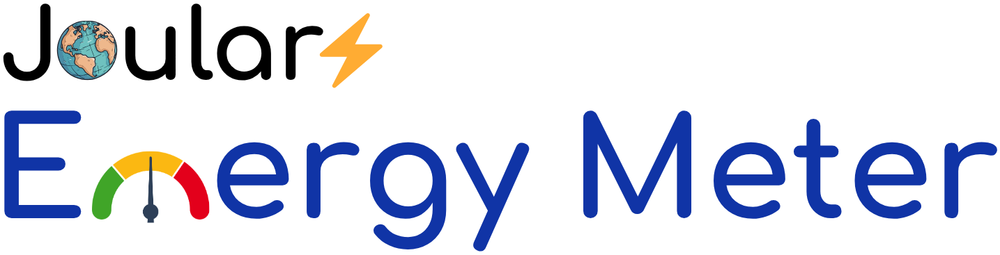
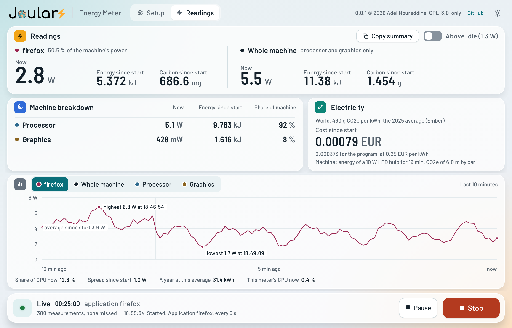
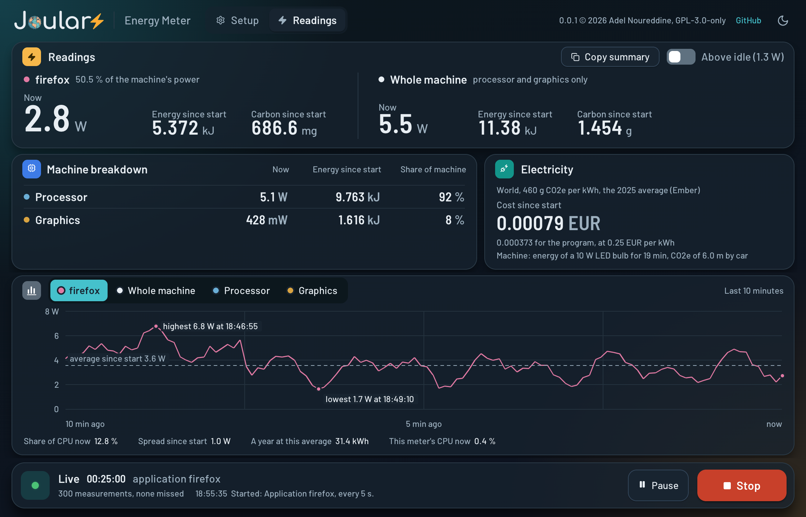
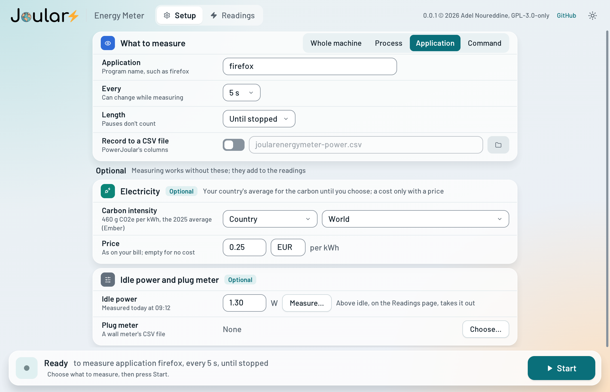
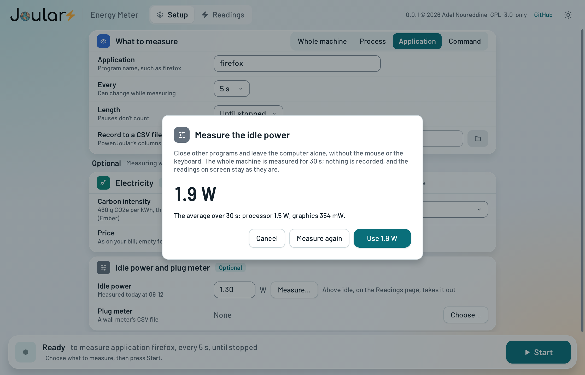

# <a href="https://www.noureddine.org/research/joular/"></a> Joular Energy Meter

[](https://www.gnu.org/licenses/gpl-3.0)
[](https://www.open-std.org/jtc1/sc22/wg14/)
[](https://www.adaic.org)



Joular Energy Meter is a desktop application that monitors, in real time, the power and energy consumption of your computer (CPU and GPU) and of a process or application, on Windows, Linux, macOS and FreeBSD.
It also estimates the carbon emissions and the cost of energy.

Detailed documentation (including user and reference guides) is available at: [https://joular.github.io/joular-energy-meter/](https://joular.github.io/joular-energy-meter/).

<table>
  <tr>
    <td><a href="screenshots/energymeter-readings-light.png"></a></td>
    <td><a href="screenshots/energymeter-readings-dark.png"></a></td>
  </tr>
  <tr>
    <td><a href="screenshots/energymeter-setup-light.png"></a></td>
    <td><a href="screenshots/energymeter-idle-light.png"></a></td>
  </tr>
</table>

## :rocket: Features

- Monitor the power and energy of the CPU, the GPU and the entire machine
- Monitor a process, an application (all its processes), or a command started from the application
- Estimate carbon emissions with the carbon intensity of your country's electricity (from [Ember](https://ember-energy.org)), of an energy source, or your own value
- Measure the idle power of the machine, to then calculate what a program consumes without it
- Read a power meter at the plug, through the CSV file its program writes
- Save the power data to CSV files, in the same format as [PowerJoular](https://github.com/joular/powerjoular)
- The same application and GUI on Linux, Windows, macOS and FreeBSD

## :satellite: Supported platforms

| OS | CPU | GPU |
|---|---|---|
| Linux | Intel, AMD, Raspberry Pi | Nvidia, AMD |
| Windows | Intel, AMD | Nvidia, AMD |
| macOS | Apple Silicon, Intel | Apple Silicon |
| FreeBSD | Intel, AMD | Nvidia |

Joular Energy Meter does the measuring through two Ada libraries we developed:
- [Joular Core](https://github.com/joular/joularcore): for CPU and GPU energy and power consumption.
- [CPU Load](https://github.com/joular/cpuload): for CPU usage of the entire system, of a process, and of an application (all its processes).

## :package: Installation

Packages are available for each system:
- Linux (x86_64 and aarch64): `.deb`, `.rpm`, Arch Linux package and AppImage. They need glibc 2.35 or newer (Debian 12, Ubuntu 22.04, Fedora 36 and later).
- macOS 15 or newer (Apple Silicon and Intel): `.dmg`.
- Windows: `.msi`, or a `.zip`.
- FreeBSD: `.pkg`, after `sudo pkg install sdl2`.

The packages are not signed: the first time, macOS asks to confirm in *System Settings > Privacy & Security*, and Windows SmartScreen in *More info > Run anyway*.

### Required privileges

The CPU load is always read, but the CPU power needs additional rights on most systems.
When they are missing, the application says what to do, and can ask the system for them.

- **Linux**: the RAPL files are readable by root only. Run `sudo chmod -R a+r /sys/class/powercap/intel-rapl` after each boot, or start the application with `sudo`.
- **Windows**: nothing to do on Windows 11. On older versions, install the [PawnIO](https://pawnio.eu) driver and run as administrator, or [Hubblo's RAPL driver](https://github.com/hubblo-org/windows-rapl-driver).
- **macOS**: `powermetrics` needs root. Start the application with `sudo` from Terminal, or let it restart itself with admin rights.
- **FreeBSD**: load the cpuctl driver (`sudo kldload cpuctl`) and start the application with `sudo` under X11.
- GPUs and Raspberry Pi need nothing.

## :floppy_disk: Compilation

You need SDL2 (2.0.18 or newer), and LVGL 9.6 in the `lvgl` folder:

```bash
git clone https://github.com/joular/joular-energy-meter
cd joular-energy-meter
git init lvgl && git -C lvgl fetch --depth 1 https://github.com/lvgl/lvgl.git 8df3de9c4c5e45ad7b0fef5adc2fa6eaa5d21579 && git -C lvgl checkout FETCH_HEAD
```

Then, with [Alire](https://alire.ada.dev), which brings GNAT, Joular Core and CPU Load:

```bash
alr build
```

The program is `bin/joularenergymeter`.
Building without Alire (needed on FreeBSD), and making the packages, are described in the [documentation](https://joular.github.io/joular-energy-meter/ref/compilation.html).

## :newspaper: License

Joular Energy Meter is licensed under the GNU GPL 3 license only (GPL-3.0-only).

Copyright (c) 2026, Adel Noureddine.
All rights reserved. This program and the accompanying materials are made available under the terms of the GNU General Public License v3.0 only (GPL-3.0-only) which accompanies this distribution, and is available at: https://www.gnu.org/licenses/gpl-3.0.en.html

Third-party work and dependencies:
- Joular Core and CPU Load are licensed LGPL-3.0-only.
- SDL2 is licensed zlib.
- LVGL, MIT licence, Copyright (c) 2025 LVGL Kft (`lvgl/LICENCE.txt`).
- Barlow font, SIL Open Font License 1.1, Copyright 2017 The Barlow Project Authors (`src/fonts/OFL.txt`).
- Montserrat font (built into LVGL), SIL Open Font License 1.1, Copyright 2024 The Montserrat.Git Project Authors.
- Carbon intensity of electricity by country: Ember, [Yearly Electricity Data](https://ember-energy.org/data/yearly-electricity-data/) and [Monthly Electricity Data](https://ember-energy.org/data/monthly-electricity-data/), CC BY 4.0 (`data/carbon-intensity.csv`, `data/carbon-intensity-monthly.csv`).
- Everyday equivalents: US EPA, [Greenhouse Gas Equivalencies Calculator, Calculations and References](https://www.epa.gov/energy/greenhouse-gas-equivalencies-calculator-calculations-and-references).
- Lucide icons, ISC licence, Copyright Lucide Contributors 2022, and Cole Bemis 2013-2022 for the parts from Feather (`src/fonts/LICENCE-Lucide.txt`).
- Font Awesome Free 5 symbols (built into LVGL), SIL Open Font License 1.1, Fonticons, Inc.

Author : Prof. Adel Noureddine
